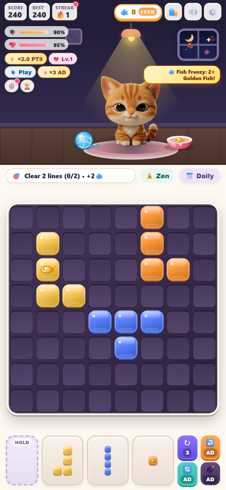

# 🐱 Mochi Pop!

**Cozy 3D Virtual Cat & 8×8 Candy Block Puzzle for Android & Web**

 

 

  

Always points to the latest signed release as <code>mochi-pop-puzzle.apk</code> — <a href="https://jemangr.github.io/mochi-pop-puzzle-releases/">Play Online</a> • <a href="https://github.com/jemangr/mochi-pop-puzzle-releases/releases">View all releases</a> • <a href="CHANGELOG.md">Changelog</a>

  

  

---

## 📱 Live Gameplay Showcase

  
  &nbsp;&nbsp;&nbsp;&nbsp;
  

  <em>☀️ Sunny Daytime Classic Play &nbsp;&nbsp;•&nbsp;&nbsp; 🌙 Cozy Night Lamp &amp; 90s Blitz Mode</em>

---

## ✨ What's New in v0.9.0

- **⏱️ 90s Blitz Rush Mode:** Fast-paced 90-second timed puzzle mode that awards `+2s` per cleared line (`+5s` on multi-line combos), automatically rescues deadlocked trays until time expires, and tracks its own **Blitz Best Score**.
- **🎯 Hammer Target Reticle & 💣 3×3 Bomb Outcome Preview:** Hovering in **🔨 Hammer** mode highlights the target cell with a live `CRACK` / `SMASH` reticle; aiming a **💣 Bomb** displays exact affected block, ice, crate, and fish counts before you drop.
- **🎟️ Album Pity System & Token Shop:** Guarantees a non-duplicate **Mochi Moments** sticker card after 2 duplicates in a row, and swaps duplicate **Tokens** (`2 🎟️ → +1 🔨 Hammer` or `+1 ↻ Rotate`) right inside the Album.
- **🐟 3rd Mini-Game — Fish Rain Catcher:** Steer Mochi smoothly left & right with touch/mouse drag or taps to catch falling golden fish before the timer ends!
- **💡 Interactive Hanging Lamp, Window Peek & Theme Music:** Tap the overhead **Hanging Lamp** to toggle cozy Night Mode, tap the **Window** to make Mochi inspect the weather, and enjoy distinct **Beach** & **Winter** Web Audio music loops matching your room theme.
- **🌐 Live Play-in-Browser Web Demo:** Try the full offline-capable PWA directly on GitHub Pages at [https://jemangr.github.io/mochi-pop-puzzle-releases/](https://jemangr.github.io/mochi-pop-puzzle-releases/).

---

## 🎮 Key Features

| Feature | Highlights |
| :--- | :--- |
| 🧩 **8×8 Puzzle Modes** | Play **Classic**, **🧘 Zen**, **⏱️ 90s Blitz**, **📖 20 Story Levels (60⭐)**, **☀️ Daily Seeded Challenge**, or **MCH:** Friend Challenges with **Hold / Rotate / Hammer / Refresh / Bomb / Undo**. |
| 💥 **Special Tiles & Smart Previews** | Crack 2-hit **Ice** & **Wooden Crates**, detonate **3×3 Bombs** with live area counts, launch **Rockets**, pop **Rainbow** crystals, and preview live `+pts` badges. |
| 🐾 **Living 3D Pet (Mochi)** | Pet Mochi's ears, chin & belly, feed fish treats, tap the **Lamp** or **Window**, play with toys, log entries in **Mochi's Diary**, and climb **Friendship Lv.1–50**. |
| 🐟 **3 Cozy Mini-Games & 🏅 Trophy Room** | Play **🔴 Laser Dash**, **🍪 Cozy Bakery**, and **🐟 Fish Rain Catcher**, and unlock **10 Trophy Medals**. |
| 🛍️ **Closet, Album Pity & Photo Studio** | Customize hats, scarves, collars, fur coats, rugs, room themes & tile skins, unlock cards with **Duplicate Pity + Token Trades**, and design `540×680` **Postcards**. |
| 🗓️ **Monthly Archive & Cloud Backup** | Replay missed Daily Challenges, claim **Purr League** standings & **⭐ Stars**, and transfer progress across devices with `MOCHI-XXXX-XXXX` codes or `.json` files. |
| 🔊 **Audio Mixer & Accessibility** | Independent Music (with Peach, Night, Beach & Winter themes), SFX & Cat voice sliders, 6 languages (`EN / EL / DE / ES / FR / TR`), **Colorblind Shapes**, and **30 FPS Power Saver**. |

---

## 📲 How to Play or Install

- **🌐 Play Instantly in Browser:** Open **[https://jemangr.github.io/mochi-pop-puzzle-releases/](https://jemangr.github.io/mochi-pop-puzzle-releases/)** on desktop or mobile (installable as an offline PWA).
- **📱 Install on Android (`8.0+`):**
  1. Tap **[DOWNLOAD APK](https://github.com/jemangr/mochi-pop-puzzle-releases/releases/latest/download/mochi-pop-puzzle.apk)** above to download `mochi-pop-puzzle.apk`.
  2. Open the downloaded `.apk` on your Android device and allow *"Install unknown apps"* if prompted.
  3. Future updates notify you inside **Settings → Check for App Update**.

---

## 🔗 Links & Legal

- ▶️ **Play in Browser:** [https://jemangr.github.io/mochi-pop-puzzle-releases/](https://jemangr.github.io/mochi-pop-puzzle-releases/)
- 🌐 **Official Website:** [https://jemangr.app](https://jemangr.app)
- 📦 **All Releases:** [GitHub Releases](https://github.com/jemangr/mochi-pop-puzzle-releases/releases)
- 📝 **Release History:** [CHANGELOG.md](CHANGELOG.md)
- 🔒 **Privacy Policy:** [PRIVACY_POLICY.md](PRIVACY_POLICY.md)
- ✉️ **Support:** `support@jemangr.app`
