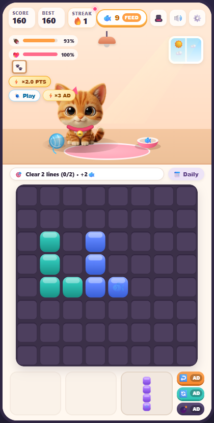

# 🐱 Mochi Pop! — Cozy Pet & Block Puzzle

> **Play, clear combos, and don't let Mochi go hungry — or he'll sulk and turn his back on you!**

  
  &nbsp;&nbsp;&nbsp;
  

  

  <strong>Android Releases:</strong>
  <a href="https://github.com/jemangr/mochi-pop-puzzle-releases/releases">
    <code>View Releases (mochi-pop-puzzle.apk — first build coming soon)</code>
  </a>

---

## ✨ Features

- **Expressive Virtual Cat (Mochi):**
  - Follows your finger with his eyes while you drag puzzle blocks.
  - Jumps with joy on combos, sweats when the board fills up, and cries if you run out of moves.
  - **Offline Hunger & Sulking:** Leave him alone for hours and his hunger drops — come back to find him turned away with puffed cheeks until you feed him!
- **Addictive 8×8 Block Puzzle:**
  - Drag & drop colorful pieces with live line-clear previews and combo multipliers.
  - Break blocks containing **Golden Fish (`🐟`)** to fill Mochi's bowl.
- **Closet & Cosmetics (`🎩`):**
  - Unlock cute accessories (Pink Bow, Berry Hat, Cool Shades, King Crown) with the fish treats you earn.
- **Settings & Accessibility (`⚙️`):**
  - Independent toggles for **Sound Effects**, **Visual Effects** (particles & floating scores), and **Vibration / Haptics**.
  - Built-in **Error Report (`🐞`)** that collects diagnostics and sends them directly to **contact@jemangr.app**.

---

## 📱 How to Install (Android)

1. Tap the **Download Latest APK** button above (`mochi-pop-puzzle.apk`).
2. Open the downloaded `.apk` file on your Android device.
3. If prompted, allow installation from your browser/file manager (**Install unknown apps**).
4. Launch **Mochi Pop!** and keep Mochi happy!

> *Note: Every release publishes a constant `mochi-pop-puzzle.apk` file (a copy of the latest build), so the download button above always gives you the newest version.*

---

## 🐞 Support & Bug Reports

Found a bug or have feedback?
- Use the in-game **Settings (`⚙️`) → Report a Bug / Error** button, or
- Email directly: **[contact@jemangr.app](mailto:contact@jemangr.app)**

---

## 🔒 License

**Closed Source — All Rights Reserved.**  
Copyright © 2026 **jemangr** (`contact@jemangr.app`). See [LICENSE](LICENSE) for full terms.
