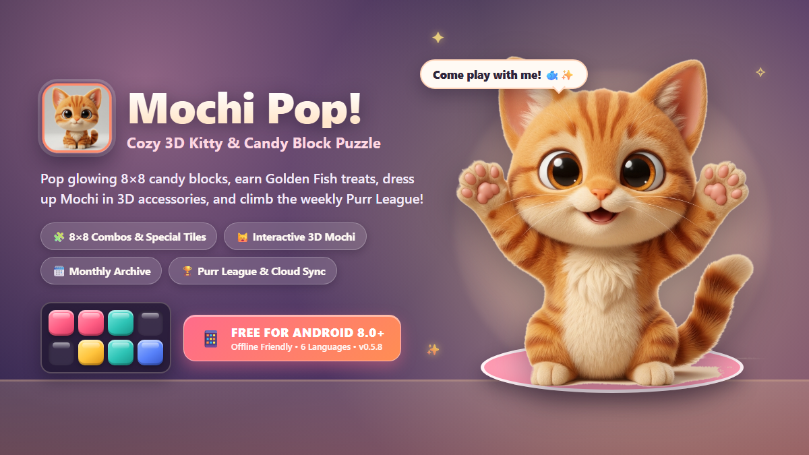

# 🐱 Mochi Pop!

**Cozy 3D Virtual Cat & 8×8 Candy Block Puzzle for Android**

 

 

Always points to the latest signed release as <code>mochi-pop-puzzle.apk</code> — <a href="https://github.com/jemangr/mochi-pop-puzzle-releases/releases">View all releases</a> • <a href="CHANGELOG.md">Changelog</a>

  

  

---

## 📱 Live Gameplay Showcase

  
  &nbsp;&nbsp;&nbsp;&nbsp;
  

---

## ✨ What's New in v0.8.0 (including v0.6.0 & v0.7.0)

- **🔨 Toy Hammer Power-Up:** Tap any block on the 8×8 board to smash it on demand or crack 1 layer of crystal Ice / Wooden Berry Crate (`+2 🔨` from Rewarded Ad when empty).
- **🌙 Adventure Story Chapters (`Ch.1–Ch.5`, 20 Levels / 60⭐):** Progress across **Cozy Morning**, **Frosty Window**, **Starry Attic**, **Garden Terrace**, and **Moonlit Loft** with wooden crates, targeted color clears, and star rewards.
- **📖 Mochi's Diary, Chin-Scratch Petting & Photo Studio Stickers:** Log Mochi's meals, Story wins, mini-games & postcards in **Mochi's Diary**, trigger extra blissful chin-scratch purrs, and stamp unlocked Album stickers onto `540×680` custom Postcards.
- **🔁 Seeded Classic Rematches & Live Point Preview:** Replay exact Classic piece sequences via **Rematch Same Seed**, see live `+pts` point previews inside hover line-clear badges, and open **Keyboard Controls** (`⌨️`) anytime.
- **🍪 2 Cozy Mini-Games & 🏅 Trophy Room:** Play **Laser Dash** and **Cozy Bakery** with custom upbeat Web Audio loops, unlock 10 permanent Medals, and enjoy Lv.15–50 Friendship perks + 60 FPS board rendering.

---

## 🎮 Key Features

| Feature | Highlights |
| :--- | :--- |
| 🧩 **Tactile 8×8 Block Puzzle** | Drag & drop glossy 3D blocks (or play via Keyboard!), trigger multi-line **Combos**, fill **Purr Rush**, use **Hold / Rotate / Hammer / Refresh / Bomb / Undo**, or chill anytime in **Zen Mode**. |
| 💥 **Special Tiles & Crates** | Crack 2-hit **Ice** blocks & **Wooden Crates**, detonate **3×3 Kitty Bombs**, launch **Rockets**, pop **Rainbow** crystals, and open **Gift** & **Tuna** bonuses. |
| 🗺️ **Adventure Story & Mini-Games** | Beat 20 curated goal levels (`60⭐`) + **Purr League ⭐ Stars**, or jump into **Laser Dash** & **Cozy Bakery** 15-second mini-games. |
| 🐾 **Living 3D Pet (Mochi)** | Pet Mochi's ears, chin & belly, feed fish treats, play with interactive toys, check **Mochi's Diary**, and level up **Friendship Lv.1–50**. |
| 🛍️ **Closet, Photo Studio & Trophy Room** | Dozens of unlockable hats, scarves, bell collars, fur coats, rugs, room themes, tile skins, `540×680` **Postcard Studio** & **10 Trophy Medals**. |
| 🗓️ **Daily Quests, Challenge Links & Cloud Backup** | Seeded daily boards, **Month Archive**, shareable `MCH:<seed>:<score>:<name>` Friend Challenges, and cross-device `MOCHI-XXXX-XXXX` cloud transfer + `.json` export. |
| 🔊 **Audio Mixer & Accessibility** | Independent Music, Puzzle SFX & Cat voice sliders, 6 languages (`EN / EL / DE / ES / FR / TR`), **Colorblind Shapes**, **30 FPS Power Saver**, and adjustable **Touch Drag Height**. |

---

## 📲 How to Install on Android

1. Tap **[DOWNLOAD APK](https://github.com/jemangr/mochi-pop-puzzle-releases/releases/latest/download/mochi-pop-puzzle.apk)** above to download `mochi-pop-puzzle.apk`.
2. Open the downloaded `.apk` file on your Android device (**Android 8.0+**).
3. Allow *"Install unknown apps"* for your browser/files app if prompted — future updates notify you automatically inside **Settings → Check for App Update**.

---

## 🔗 Links & Legal

- 🌐 **Official Website:** [https://jemangr.app](https://jemangr.app)
- 📦 **All Releases:** [GitHub Releases](https://github.com/jemangr/mochi-pop-puzzle-releases/releases)
- 📝 **Release History:** [CHANGELOG.md](CHANGELOG.md)
- 🔒 **Privacy Policy:** [PRIVACY_POLICY.md](PRIVACY_POLICY.md)
- ✉️ **Support:** `support@jemangr.app`
